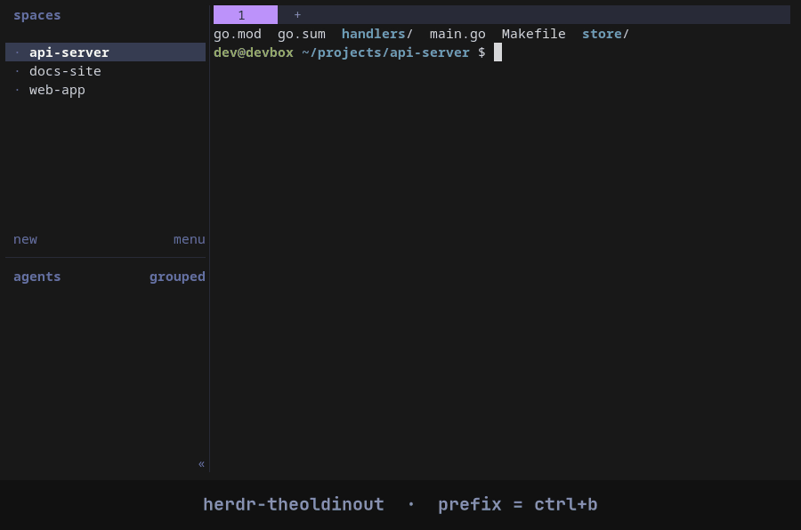

# herdr-theoldinout



A [herdr](https://herdr.dev) plugin: vim's jump list (`ctrl+o` / `ctrl+i`) for herdr, **across every machine your
herdr window reaches** (`herdr machine list`). `prefix+o` takes you back to where you were, `prefix+i` forward again, and `prefix+shift+i` lists the history
(workspace and pane names, newest first) so you can jump straight to any place in it.

A jump is any change of the focused pane, or of the machine the window shows. Going back to another machine switches
the window there and focuses the pane. A new jump after going back drops what was ahead, as a browser does. The
history (200 places) survives a restart of the daemon.

## Install

```sh
herdr plugin install Benjmhart/herdr-theoldinout
```

In `~/.config/herdr/config.toml` (herdr's own `prefix+o` opens the notification target; move it):

```toml
[keys]
open_notification_target = "prefix+shift+o"

[[keys.command]]
key = "prefix+o"
type = "plugin_action"
command = "benjmhart.oldinout.back"
description = "jump back"

[[keys.command]]
key = "prefix+i"
type = "plugin_action"
command = "benjmhart.oldinout.forward"
description = "jump forward"

[[keys.command]]
key = "prefix+shift+i"
type = "plugin_action"
command = "benjmhart.oldinout.pick"
description = "jump history"
```

Then start the daemon with your desktop session, on the machine you sit at (xmonad startup hook, i3/sway `exec`):

```sh
python3 "$(ls -dt ~/.config/herdr/plugins/github-installations/benjmhart.oldinout-*/*/checkout/oldinout.py | head -1)" daemon
```

Install the plugin on every machine you reach, too: the keys run on the machine the window is showing.


### Windows

Runs on herdr's Windows build (tested on Windows 11, herdr 0.9.5: the daemon, history, and back across machines, to a
WSL Arch and back to Windows). Windows' own `python3` is a Microsoft Store
stub: install Python with python.org's **Python install manager**, which answers to `python3`. The list needs `python3 -m pip install windows-curses`. Start the daemon at logon without a console window (`pythonw <the plugin's folder>\oldinout.py daemon`); it drives Windows Terminal with user32 and SendKeys through one resident PowerShell. The other machines it reaches over ssh run Linux or macOS; a WSL distro on the same PC is one (`herdr machine add`). Under WSL the same driver goes through `powershell.exe` (herdr-queues' copy of it is tested there; this plugin's is not yet).

## How it works

The keys run on the server the window shows, which may have no way back to your screen, so they only write
`back`/`forward` to the plugin's state there. The daemon keeps one ssh pipe per machine (the same ssh herdr uses). At
the far end a small helper streams that server's `pane.focused` events and those requests, and focuses panes on
command (`pane.focus`). The daemon records a jump when the focused pane changes in the window you are using, or the
window switches machine, with the workspace and pane names as they were then. After each change it writes a copy of
the history to every machine through the same pipes (`history.<desk>.json`, one per machine running a daemon), so the
list (`prefix+shift+i`, a popup on whichever machine the window shows) reads the newest copy locally; Enter sends
`goto <desk> N` back the way `back`/`forward` go, and only that desk's daemon acts on it. Choosing from the list moves
your place in the history without dropping anything. To go to another machine it drives the window's Goto picker (its Goto keys from herdr's
`config.toml`, default `prefix+g`; `/`, the machine's label, Enter), as [herdr-queues](https://github.com/Benjmhart/herdr-queues) does.

Needs X11 and `xdotool`, herdr's window title in its default
shape (`{hostname}: {workspace}`, a `herdr: ` prefix is fine), and python3 on every machine. A request is ignored
while the screen is locked. `oldinout.py history` prints the list (`>` marks where you are).

## Test

`python3 test_oldinout.py` (no herdr needed).

CI (`.github/workflows/ci.yml`) runs the tests on Linux, macOS and Windows and links the plugin into a real herdr on every push. Tag a release only from a commit whose run is green.

MIT licence.
